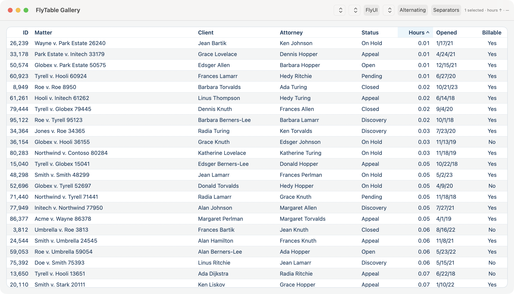

# FlyTable

A table for Swift that is built the way the best Mac tables are built: a headless core, a
custom-drawn native renderer, and a SwiftUI API that reads like Apple's `Table` where Apple's is
right and goes further where it is not.

- **Headless core** (`FlyTableCore`, pure Swift, no UI dependency): columns and width policies,
  layout resolution with NSTableView-style autoresizing, row geometry (O(1) uniform rows, O(log n)
  variable rows), multi-key sort as an index permutation, identifier-based selection with anchor and
  focus, typed cell values, and a bounded cell cache.
- **Native renderer** (macOS): one view inside an `NSScrollView` that draws only the visible rows ×
  visible columns from cached Core Text lines, with the floating header and pinned columns painted
  in the same pass. Cost per frame is O(visible cells), so one million rows scroll like one hundred.
- **SwiftUI API** (`FlyTable`): rows, columns from a result builder, and host-owned bindings for
  selection, sort order and column layout.

```swift
import FlyTable

FlyTable(matters, selection: $selection, sortOrder: $sort, layout: $layout) {
  FlyColumn("ID", value: \.id).width(.fit).pinned()
  FlyColumn("Matter", value: \.title).width(.flex(2))
  FlyColumn("Client", value: \.client)
  FlyColumn("Hours", value: \.hours)            // numeric: trailing, tabular digits
  FlyColumn("Opened", value: \.opened)
}
.tableStyle(.card)               // .inset, .fullWidth, .plain, .card
.theme(.flyUI)                   // .system (Finder, Mail) or .flyUI (FlyUI's default table)
.density(.comfortable)           // 24 / 28 / 36 pt rows; the header matches
.alternatingRowBackgrounds()
.onRowActivate { ids in open(ids) }
.contextMenu { ids in [FlyMenuItem("Open") { open(ids) }] }
```

What the renderer gives you without asking: click a header to sort, click again to reverse,
Shift-click for a secondary key; drag a header divider to resize; right-click the header to show,
hide and reset columns; click, Cmd-click, Shift-click, arrows, Shift-arrows, Option-arrows, Home,
End, Page Up/Down, Cmd-A and Escape for selection; right-click selects the row before the menu
appears; double-click or Return activates; hover highlight; emphasized selection in the key window
and grey selection when it is not; alternating rows, row and column separators as options.



## Status

Version 0.1.0, macOS only. The iOS renderer, inline editing, outline rows, floating group rows,
variable row heights in the renderer, per-cell accessibility elements and the benchmark target
are scheduled; see `docs/proposal.md` §5.5 for the milestones and §5.4 for the acceptance bar.
The floor is macOS 15, iOS 18 and visionOS 2, matching FlyUI.

## Run the gallery

```sh
swift run FlyTableGallery
```

Synthetic matters, switchable between 1,000, 100,000 and 1,000,000 rows, with style, density,
alternating rows and separators in the toolbar.

## Test

```sh
swift test
```

## Why not SwiftUI `Table` or `NSTableView`

`docs/proposal.md` and `docs/research/` hold the survey this design came from: every open-source
Swift table and grid on GitHub, Apple's first-party APIs and their documented limits, the design
systems and apps whose tables people admire, and the engineering literature on virtualization.
In short: SwiftUI `Table` locks row height, cannot persist column widths and hangs at a few
thousand rows on macOS; `NSTableView` recycles rows but not columns; the scalable answer, proven
by Glide on the web and NGTable on the Mac, is a custom-drawn viewport with a cell cache.

## Licence

MIT. Copyright 2026 Whizbang Technologies.
